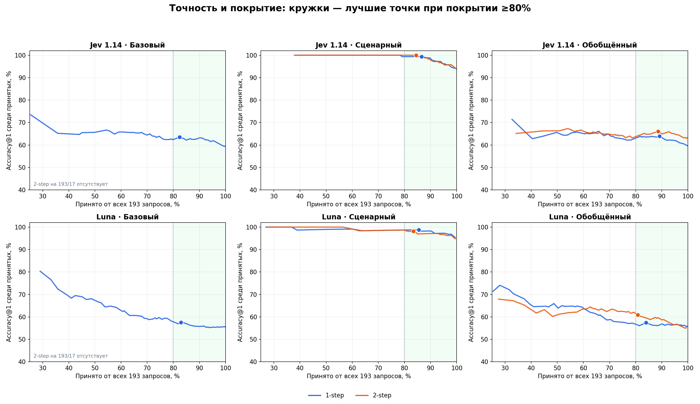
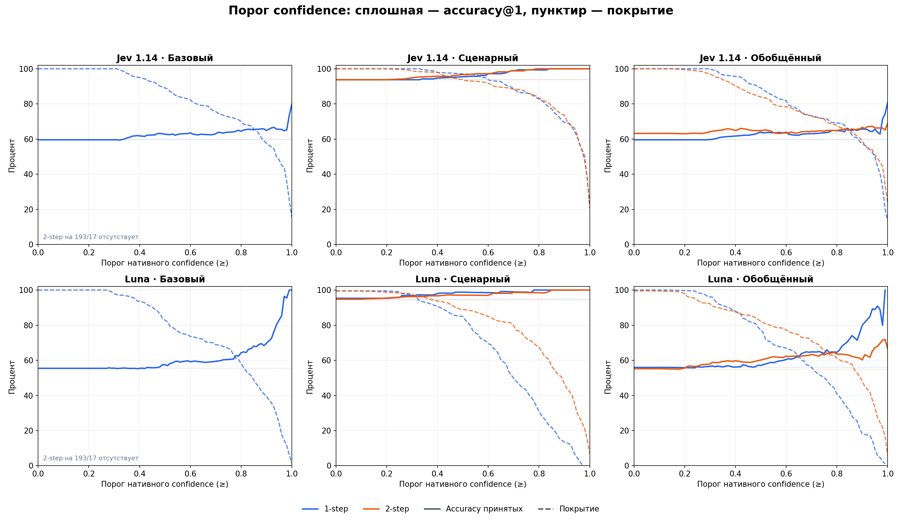

# Confidence и accuracy@1: exp2, русские промпты

Текущая корзина: 193 запроса, 17 кандидатов. Модели Jev 1.14 и Luna. Только завершённые прогоны с совпадающими SHA-256 bucket/corpus и текущих RU-промптов. Для повторов выбирается последний завершённый прогон каждой комбинации. 2-step использует shortlist=5. Экспорт stage 1 не считается отдельным повтором.

## Как читать результаты

Принимается успешный ответ с **нативным response.answers.subagent.confidence ≥ порог**. Поле probability/p_max не используется как замена. Coverage = принято / 193; accuracy@1 принятых = правильных среди принятых / принято. Отклонённые вопросы требуют fallback, его качество здесь не измеряется.

Исходная accuracy без фильтра включает ошибки API как промахи. При пороге 0 принимаются только успешные ответы с confidence, поэтому у Luna с API-ошибкой уже есть один вопрос за бортом. Таблицы отдельно показывают низкий confidence и отсутствие результата; это не одно и то же.

Основное допущение: сохранить **не менее 80%** корзины (не меньше 155/193). Среди допустимых порогов максимизируется accuracy принятых; при равной точности выбирается большее покрытие. Ниже также ограничения 90%, 70% и 50%. Это выбранные аналитиком компромиссы, не заданная пользователем стоимость ошибки.

## Основной компромисс: покрытие ≥80%

| Промпт | Модель | Этап | Без фильтра @1 | Порог ≥ | Принято | Покрытие | @1 принятых | За бортом | Из них правильных |
| --- | --- | --- | ---: | ---: | ---: | ---: | ---: | ---: | ---: |
| Базовый | Jev 1.14 | 1-step | 59.59% | 0.60 | 159/193 | 82.38% | 63.52% (101/159) | 34 | 14 |
| Базовый | Luna | 1-step | 55.44% | 0.50 | 160/193 | 82.90% | 57.50% (92/160) | 33 | 15 |
| Сценарный | Jev 1.14 | 1-step | 93.78% | 0.72 | 167/193 | 86.53% | 99.40% (166/167) | 26 | 15 |
| Сценарный | Jev 1.14 | 2-step | 93.78% | 0.79 | 163/193 | 84.46% | 100.00% (163/163) | 30 | 18 |
| Сценарный | Luna | 1-step | 94.82% | 0.47 | 165/193 | 85.49% | 98.79% (163/165) | 28 | 20 |
| Сценарный | Luna | 2-step | 94.30% | 0.62 | 161/193 | 83.42% | 98.14% (158/161) | 32 | 24 |
| Обобщённый | Jev 1.14 | 1-step | 59.59% | 0.50 | 172/193 | 89.12% | 63.95% (110/172) | 21 | 5 |
| Обобщённый | Jev 1.14 | 2-step | 63.21% | 0.42 | 171/193 | 88.60% | 66.08% (113/171) | 22 | 9 |
| Обобщённый | Luna | 1-step | 55.96% | 0.43 | 162/193 | 83.94% | 57.41% (93/162) | 31 | 15 |
| Обобщённый | Luna | 2-step | 54.92% | 0.52 | 156/193 | 80.83% | 60.90% (95/156) | 37 | 11 |





## Другие ограничения покрытия

В ячейке: **порог; принято; accuracy@1**. Из-за одинаковых confidence нельзя всегда получить ровно заданное покрытие. Порог не разделяет равные значения.

| Промпт | Модель | Этап | ≥90% | ≥80% | ≥70% | ≥50% |
| --- | --- | --- | --- | --- | --- | --- |
| Базовый | Jev 1.14 | 1-step | 0.48; 174; 63.22% | 0.60; 159; 63.52% | 0.79; 137; 64.96% | 0.93; 105; 66.67% |
| Базовый | Luna | 1-step | 0.43; 177; 55.93% | 0.50; 160; 57.50% | 0.59; 144; 59.72% | 0.84; 99; 66.67% |
| Сценарный | Jev 1.14 | 1-step | 0.68; 174; 98.28% | 0.72; 167; 99.40% | 0.84; 151; 100.00% | 0.84; 151; 100.00% |
| Сценарный | Jev 1.14 | 2-step | 0.62; 174; 97.70% | 0.79; 163; 100.00% | 0.79; 163; 100.00% | 0.79; 163; 100.00% |
| Сценарный | Luna | 1-step | 0.41; 174; 98.28% | 0.47; 165; 98.79% | 0.47; 165; 98.79% | 0.65; 116; 99.14% |
| Сценарный | Luna | 2-step | 0.44; 179; 97.21% | 0.62; 161; 98.14% | 0.70; 154; 98.70% | 0.85; 109; 100.00% |
| Обобщённый | Jev 1.14 | 1-step | 0.48; 175; 62.86% | 0.50; 172; 63.95% | 0.77; 136; 63.97% | 0.84; 127; 66.14% |
| Обобщённый | Jev 1.14 | 2-step | 0.37; 179; 65.92% | 0.42; 171; 66.08% | 0.42; 171; 66.08% | 0.94; 104; 67.31% |
| Обобщённый | Luna | 1-step | 0.37; 174; 56.90% | 0.43; 162; 57.41% | 0.54; 136; 58.82% | 0.73; 100; 65.00% |
| Обобщённый | Luna | 2-step | 0.31; 175; 58.86% | 0.52; 156; 60.90% | 0.70; 137; 63.50% | 0.79; 121; 64.46% |

## Почему высокий confidence не устраняет все промахи

Jev 1.14, обобщённый промпт, 2-step: gold отсутствует в shortlist у 32 вопросов; 21 из них получили confidence ≥0.95, в том числе 10 — ровно 1.

Luna, обобщённый промпт, 2-step: gold отсутствует в shortlist у 38 вопросов; 12 из них получили confidence ≥0.95, в том числе 4 — ровно 1.

Второй этап выбирает внутри сокращённого набора и может уверенно выбрать неверный глобальный маршрут.

Часть уверенных промахов — расхождение описанных возможностей и единственной gold-метки: навигация/service_navigation, вовлечённость/metrics, создание встреч/meetings. Порог не разрешает это противоречие разметки. Сценарный промпт содержит правила, настроенные по этой же корзине.

При confidence=1 точность всё ещё не обязана быть 100%:

| Промпт | Модель | Этап | Принято с confidence=1 | Правильно | @1 |
| --- | --- | --- | ---: | ---: | ---: |
| Базовый | Jev 1.14 | 1-step | 30 | 24 | 80.00% |
| Базовый | Luna | 1-step | 3 | 3 | 100.00% |
| Сценарный | Jev 1.14 | 1-step | 43 | 43 | 100.00% |
| Сценарный | Jev 1.14 | 2-step | 40 | 40 | 100.00% |
| Сценарный | Luna | 1-step | 0 | 0 | — |
| Сценарный | Luna | 2-step | 14 | 14 | 100.00% |
| Обобщённый | Jev 1.14 | 1-step | 26 | 21 | 80.77% |
| Обобщённый | Jev 1.14 | 2-step | 45 | 31 | 68.89% |
| Обобщённый | Luna | 1-step | 0 | 0 | — |
| Обобщённый | Luna | 2-step | 12 | 8 | 66.67% |

## Ограничения подбора

Пороги выбраны после просмотра gold на всех этих 193 вопросах. Это operating points на данных разработки, а не доказанные production-пороги. Малая корзина, связанные сценарии и перебор порогов дают оптимистичную оценку. Выбери рабочий порог на отдельном dev-наборе и проверь один раз на новых данных.

Эмпирические 100% принятых ответов не дают гарантии. В summary.json сохранены номинальные Wilson 95% интервалы для заранее фиксированного порога; они не учитывают подбор порога/промпта и зависимости между вопросами.

Рост accuracy среди принятых не означает рост числа правильных ответов на всей корзине: часть правильных ответов тоже отправляется в fallback. Для этого сохранены accepted_correct, withheld_correct и correct_automated_share_of_bucket. Числа confidence разных моделей и этапов не считаются общей калиброванной шкалой.

## Детальные пороги по каждому прогону

### Базовый · Jev 1.14 · 1-step

Источник: `/home/xaeliudzyh/SberAI/jev-as-orchestrator/experiments/exp2/1-step/typesafe__jev-1.14_20261109T110750.875574+0300`. Статусы: `{'ok': 193}`. Нативный confidence отсутствует у 0 успешных ответов.

| Порог ≥ | Принято | Правильно | Ошибочных принято | @1 | Покрытие | За бортом | Низкий confidence | Нет ответа/confidence | Правильных отсеяно |
| ---: | ---: | ---: | ---: | ---: | ---: | ---: | ---: | ---: | ---: |
| 0.00 | 193 | 115 | 78 | 59.59% | 100.00% | 0 | 0 | 0 | 0 |
| 0.30 | 193 | 115 | 78 | 59.59% | 100.00% | 0 | 0 | 0 | 0 |
| 0.40 | 182 | 112 | 70 | 61.54% | 94.30% | 11 | 11 | 0 | 3 |
| 0.50 | 171 | 107 | 64 | 62.57% | 88.60% | 22 | 22 | 0 | 8 |
| 0.60 | 159 | 101 | 58 | 63.52% | 82.38% | 34 | 34 | 0 | 14 |
| 0.70 | 146 | 92 | 54 | 63.01% | 75.65% | 47 | 47 | 0 | 23 |
| 0.80 | 135 | 87 | 48 | 64.44% | 69.95% | 58 | 58 | 0 | 28 |
| 0.90 | 111 | 72 | 39 | 64.86% | 57.51% | 82 | 82 | 0 | 43 |
| 0.95 | 93 | 61 | 32 | 65.59% | 48.19% | 100 | 100 | 0 | 54 |
| 0.98 | 69 | 45 | 24 | 65.22% | 35.75% | 124 | 124 | 0 | 70 |
| 0.99 | 49 | 36 | 13 | 73.47% | 25.39% | 144 | 144 | 0 | 79 |
| 1.00 | 30 | 24 | 6 | 80.00% | 15.54% | 163 | 163 | 0 | 91 |

Интервалы confidence (не накопительные пороги):

| Интервал | Ответов | Правильно | @1 | Средний native confidence |
| --- | ---: | ---: | ---: | ---: |
| [0.00, 0.50) | 22 | 8 | 36.36% | 0.403 |
| [0.50, 0.70) | 25 | 15 | 60.00% | 0.592 |
| [0.70, 0.80) | 11 | 5 | 45.45% | 0.743 |
| [0.80, 0.90) | 24 | 15 | 62.50% | 0.854 |
| [0.90, 0.95) | 18 | 11 | 61.11% | 0.924 |
| [0.95, 0.98) | 24 | 16 | 66.67% | 0.964 |
| [0.98, 1.00] | 69 | 45 | 65.22% | 0.991 |

### Базовый · Luna · 1-step

Источник: `/home/xaeliudzyh/SberAI/jev-as-orchestrator/experiments/exp2/1-step/openai__gpt-6-luna-decisions_20261109T110934.530535+0300`. Статусы: `{'ok': 193}`. Нативный confidence отсутствует у 0 успешных ответов.

| Порог ≥ | Принято | Правильно | Ошибочных принято | @1 | Покрытие | За бортом | Низкий confidence | Нет ответа/confidence | Правильных отсеяно |
| ---: | ---: | ---: | ---: | ---: | ---: | ---: | ---: | ---: | ---: |
| 0.00 | 193 | 107 | 86 | 55.44% | 100.00% | 0 | 0 | 0 | 0 |
| 0.30 | 189 | 105 | 84 | 55.56% | 97.93% | 4 | 4 | 0 | 2 |
| 0.40 | 180 | 100 | 80 | 55.56% | 93.26% | 13 | 13 | 0 | 7 |
| 0.50 | 160 | 92 | 68 | 57.50% | 82.90% | 33 | 33 | 0 | 15 |
| 0.60 | 142 | 84 | 58 | 59.15% | 73.58% | 51 | 51 | 0 | 23 |
| 0.70 | 133 | 79 | 54 | 59.40% | 68.91% | 60 | 60 | 0 | 28 |
| 0.80 | 112 | 72 | 40 | 64.29% | 58.03% | 81 | 81 | 0 | 35 |
| 0.90 | 76 | 53 | 23 | 69.74% | 39.38% | 117 | 117 | 0 | 54 |
| 0.95 | 47 | 39 | 8 | 82.98% | 24.35% | 146 | 146 | 0 | 68 |
| 0.98 | 22 | 21 | 1 | 95.45% | 11.40% | 171 | 171 | 0 | 86 |
| 0.99 | 12 | 12 | 0 | 100.00% | 6.22% | 181 | 181 | 0 | 95 |
| 1.00 | 3 | 3 | 0 | 100.00% | 1.55% | 190 | 190 | 0 | 104 |

Интервалы confidence (не накопительные пороги):

| Интервал | Ответов | Правильно | @1 | Средний native confidence |
| --- | ---: | ---: | ---: | ---: |
| [0.00, 0.50) | 33 | 15 | 45.45% | 0.408 |
| [0.50, 0.70) | 27 | 13 | 48.15% | 0.573 |
| [0.70, 0.80) | 21 | 7 | 33.33% | 0.761 |
| [0.80, 0.90) | 36 | 19 | 52.78% | 0.844 |
| [0.90, 0.95) | 29 | 14 | 48.28% | 0.924 |
| [0.95, 0.98) | 25 | 18 | 72.00% | 0.957 |
| [0.98, 1.00] | 22 | 21 | 95.45% | 0.987 |

### Сценарный · Jev 1.14 · 1-step

Источник: `/home/xaeliudzyh/SberAI/jev-as-orchestrator/experiments/exp2/1-step/typesafe__jev-1.14_20261109T133624.365052+0300`. Статусы: `{'ok': 193}`. Нативный confidence отсутствует у 0 успешных ответов.

| Порог ≥ | Принято | Правильно | Ошибочных принято | @1 | Покрытие | За бортом | Низкий confidence | Нет ответа/confidence | Правильных отсеяно |
| ---: | ---: | ---: | ---: | ---: | ---: | ---: | ---: | ---: | ---: |
| 0.00 | 193 | 181 | 12 | 93.78% | 100.00% | 0 | 0 | 0 | 0 |
| 0.30 | 193 | 181 | 12 | 93.78% | 100.00% | 0 | 0 | 0 | 0 |
| 0.40 | 189 | 179 | 10 | 94.71% | 97.93% | 4 | 4 | 0 | 2 |
| 0.50 | 187 | 179 | 8 | 95.72% | 96.89% | 6 | 6 | 0 | 2 |
| 0.60 | 181 | 176 | 5 | 97.24% | 93.78% | 12 | 12 | 0 | 5 |
| 0.70 | 171 | 169 | 2 | 98.83% | 88.60% | 22 | 22 | 0 | 12 |
| 0.80 | 160 | 159 | 1 | 99.38% | 82.90% | 33 | 33 | 0 | 22 |
| 0.90 | 134 | 134 | 0 | 100.00% | 69.43% | 59 | 59 | 0 | 47 |
| 0.95 | 119 | 119 | 0 | 100.00% | 61.66% | 74 | 74 | 0 | 62 |
| 0.98 | 92 | 92 | 0 | 100.00% | 47.67% | 101 | 101 | 0 | 89 |
| 0.99 | 74 | 74 | 0 | 100.00% | 38.34% | 119 | 119 | 0 | 107 |
| 1.00 | 43 | 43 | 0 | 100.00% | 22.28% | 150 | 150 | 0 | 138 |

Интервалы confidence (не накопительные пороги):

| Интервал | Ответов | Правильно | @1 | Средний native confidence |
| --- | ---: | ---: | ---: | ---: |
| [0.00, 0.50) | 6 | 2 | 33.33% | 0.383 |
| [0.50, 0.70) | 16 | 10 | 62.50% | 0.621 |
| [0.70, 0.80) | 11 | 10 | 90.91% | 0.743 |
| [0.80, 0.90) | 26 | 25 | 96.15% | 0.847 |
| [0.90, 0.95) | 15 | 15 | 100.00% | 0.929 |
| [0.95, 0.98) | 27 | 27 | 100.00% | 0.961 |
| [0.98, 1.00] | 92 | 92 | 100.00% | 0.993 |

### Сценарный · Jev 1.14 · 2-step

Источник: `/home/xaeliudzyh/SberAI/jev-as-orchestrator/experiments/exp2/2-step/typesafe__jev-1.14_20261109T133624.365052+0300`. Статусы: `{'ok': 193}`. Нативный confidence отсутствует у 0 успешных ответов.

| Порог ≥ | Принято | Правильно | Ошибочных принято | @1 | Покрытие | За бортом | Низкий confidence | Нет ответа/confidence | Правильных отсеяно |
| ---: | ---: | ---: | ---: | ---: | ---: | ---: | ---: | ---: | ---: |
| 0.00 | 193 | 181 | 12 | 93.78% | 100.00% | 0 | 0 | 0 | 0 |
| 0.30 | 190 | 181 | 9 | 95.26% | 98.45% | 3 | 3 | 0 | 0 |
| 0.40 | 189 | 181 | 8 | 95.77% | 97.93% | 4 | 4 | 0 | 0 |
| 0.50 | 181 | 175 | 6 | 96.69% | 93.78% | 12 | 12 | 0 | 6 |
| 0.60 | 177 | 172 | 5 | 97.18% | 91.71% | 16 | 16 | 0 | 9 |
| 0.70 | 170 | 168 | 2 | 98.82% | 88.08% | 23 | 23 | 0 | 13 |
| 0.80 | 161 | 161 | 0 | 100.00% | 83.42% | 32 | 32 | 0 | 20 |
| 0.90 | 142 | 142 | 0 | 100.00% | 73.58% | 51 | 51 | 0 | 39 |
| 0.95 | 121 | 121 | 0 | 100.00% | 62.69% | 72 | 72 | 0 | 60 |
| 0.98 | 98 | 98 | 0 | 100.00% | 50.78% | 95 | 95 | 0 | 83 |
| 0.99 | 73 | 73 | 0 | 100.00% | 37.82% | 120 | 120 | 0 | 108 |
| 1.00 | 40 | 40 | 0 | 100.00% | 20.73% | 153 | 153 | 0 | 141 |

Интервалы confidence (не накопительные пороги):

| Интервал | Ответов | Правильно | @1 | Средний native confidence |
| --- | ---: | ---: | ---: | ---: |
| [0.00, 0.50) | 12 | 6 | 50.00% | 0.376 |
| [0.50, 0.70) | 11 | 7 | 63.64% | 0.601 |
| [0.70, 0.80) | 9 | 7 | 77.78% | 0.760 |
| [0.80, 0.90) | 19 | 19 | 100.00% | 0.844 |
| [0.90, 0.95) | 21 | 21 | 100.00% | 0.919 |
| [0.95, 0.98) | 23 | 23 | 100.00% | 0.955 |
| [0.98, 1.00] | 98 | 98 | 100.00% | 0.992 |

### Сценарный · Luna · 1-step

Источник: `/home/xaeliudzyh/SberAI/jev-as-orchestrator/experiments/exp2/1-step/openai__gpt-6-luna-decisions_20261109T134353.903881+0300`. Статусы: `{'ok': 192, 'error': 1}`. Нативный confidence отсутствует у 0 успешных ответов.

| Порог ≥ | Принято | Правильно | Ошибочных принято | @1 | Покрытие | За бортом | Низкий confidence | Нет ответа/confidence | Правильных отсеяно |
| ---: | ---: | ---: | ---: | ---: | ---: | ---: | ---: | ---: | ---: |
| 0.00 | 192 | 183 | 9 | 95.31% | 99.48% | 1 | 0 | 1 | 0 |
| 0.30 | 188 | 182 | 6 | 96.81% | 97.41% | 5 | 4 | 1 | 1 |
| 0.40 | 174 | 171 | 3 | 98.28% | 90.16% | 19 | 18 | 1 | 12 |
| 0.50 | 164 | 162 | 2 | 98.78% | 84.97% | 29 | 28 | 1 | 21 |
| 0.60 | 134 | 132 | 2 | 98.51% | 69.43% | 59 | 58 | 1 | 51 |
| 0.70 | 96 | 95 | 1 | 98.96% | 49.74% | 97 | 96 | 1 | 88 |
| 0.80 | 60 | 60 | 0 | 100.00% | 31.09% | 133 | 132 | 1 | 123 |
| 0.90 | 26 | 26 | 0 | 100.00% | 13.47% | 167 | 166 | 1 | 157 |
| 0.95 | 9 | 9 | 0 | 100.00% | 4.66% | 184 | 183 | 1 | 174 |
| 0.98 | 0 | 0 | 0 | — | 0.00% | 193 | 192 | 1 | 183 |
| 0.99 | 0 | 0 | 0 | — | 0.00% | 193 | 192 | 1 | 183 |
| 1.00 | 0 | 0 | 0 | — | 0.00% | 193 | 192 | 1 | 183 |

Интервалы confidence (не накопительные пороги):

| Интервал | Ответов | Правильно | @1 | Средний native confidence |
| --- | ---: | ---: | ---: | ---: |
| [0.00, 0.50) | 28 | 21 | 75.00% | 0.358 |
| [0.50, 0.70) | 68 | 67 | 98.53% | 0.602 |
| [0.70, 0.80) | 36 | 35 | 97.22% | 0.751 |
| [0.80, 0.90) | 34 | 34 | 100.00% | 0.840 |
| [0.90, 0.95) | 17 | 17 | 100.00% | 0.926 |
| [0.95, 0.98) | 9 | 9 | 100.00% | 0.957 |
| [0.98, 1.00] | 0 | 0 | — | — |

### Сценарный · Luna · 2-step

Источник: `/home/xaeliudzyh/SberAI/jev-as-orchestrator/experiments/exp2/2-step/openai__gpt-6-luna-decisions_20261109T134353.903881+0300`. Статусы: `{'ok': 192, 'skipped': 1}`. Нативный confidence отсутствует у 0 успешных ответов.

| Порог ≥ | Принято | Правильно | Ошибочных принято | @1 | Покрытие | За бортом | Низкий confidence | Нет ответа/confidence | Правильных отсеяно |
| ---: | ---: | ---: | ---: | ---: | ---: | ---: | ---: | ---: | ---: |
| 0.00 | 192 | 182 | 10 | 94.79% | 99.48% | 1 | 0 | 1 | 0 |
| 0.30 | 187 | 180 | 7 | 96.26% | 96.89% | 6 | 5 | 1 | 2 |
| 0.40 | 181 | 175 | 6 | 96.69% | 93.78% | 12 | 11 | 1 | 7 |
| 0.50 | 171 | 166 | 5 | 97.08% | 88.60% | 22 | 21 | 1 | 16 |
| 0.60 | 164 | 159 | 5 | 96.95% | 84.97% | 29 | 28 | 1 | 23 |
| 0.70 | 154 | 152 | 2 | 98.70% | 79.79% | 39 | 38 | 1 | 30 |
| 0.80 | 130 | 128 | 2 | 98.46% | 67.36% | 63 | 62 | 1 | 54 |
| 0.90 | 90 | 90 | 0 | 100.00% | 46.63% | 103 | 102 | 1 | 92 |
| 0.95 | 58 | 58 | 0 | 100.00% | 30.05% | 135 | 134 | 1 | 124 |
| 0.98 | 41 | 41 | 0 | 100.00% | 21.24% | 152 | 151 | 1 | 141 |
| 0.99 | 29 | 29 | 0 | 100.00% | 15.03% | 164 | 163 | 1 | 153 |
| 1.00 | 14 | 14 | 0 | 100.00% | 7.25% | 179 | 178 | 1 | 168 |

Интервалы confidence (не накопительные пороги):

| Интервал | Ответов | Правильно | @1 | Средний native confidence |
| --- | ---: | ---: | ---: | ---: |
| [0.00, 0.50) | 21 | 16 | 76.19% | 0.360 |
| [0.50, 0.70) | 17 | 14 | 82.35% | 0.604 |
| [0.70, 0.80) | 24 | 24 | 100.00% | 0.740 |
| [0.80, 0.90) | 40 | 38 | 95.00% | 0.845 |
| [0.90, 0.95) | 32 | 32 | 100.00% | 0.924 |
| [0.95, 0.98) | 17 | 17 | 100.00% | 0.957 |
| [0.98, 1.00] | 41 | 41 | 100.00% | 0.990 |

### Обобщённый · Jev 1.14 · 1-step

Источник: `/home/xaeliudzyh/SberAI/jev-as-orchestrator/experiments/exp2/1-step/typesafe__jev-1.14_20261109T143150.585465+0300`. Статусы: `{'ok': 193}`. Нативный confidence отсутствует у 0 успешных ответов.

| Порог ≥ | Принято | Правильно | Ошибочных принято | @1 | Покрытие | За бортом | Низкий confidence | Нет ответа/confidence | Правильных отсеяно |
| ---: | ---: | ---: | ---: | ---: | ---: | ---: | ---: | ---: | ---: |
| 0.00 | 193 | 115 | 78 | 59.59% | 100.00% | 0 | 0 | 0 | 0 |
| 0.30 | 192 | 115 | 77 | 59.90% | 99.48% | 1 | 1 | 0 | 0 |
| 0.40 | 184 | 114 | 70 | 61.96% | 95.34% | 9 | 9 | 0 | 1 |
| 0.50 | 172 | 110 | 62 | 63.95% | 89.12% | 21 | 21 | 0 | 5 |
| 0.60 | 158 | 101 | 57 | 63.92% | 81.87% | 35 | 35 | 0 | 14 |
| 0.70 | 141 | 89 | 52 | 63.12% | 73.06% | 52 | 52 | 0 | 26 |
| 0.80 | 133 | 86 | 47 | 64.66% | 68.91% | 60 | 60 | 0 | 29 |
| 0.90 | 111 | 73 | 38 | 65.77% | 57.51% | 82 | 82 | 0 | 42 |
| 0.95 | 96 | 63 | 33 | 65.62% | 49.74% | 97 | 97 | 0 | 52 |
| 0.98 | 63 | 45 | 18 | 71.43% | 32.64% | 130 | 130 | 0 | 70 |
| 0.99 | 39 | 29 | 10 | 74.36% | 20.21% | 154 | 154 | 0 | 86 |
| 1.00 | 26 | 21 | 5 | 80.77% | 13.47% | 167 | 167 | 0 | 94 |

Интервалы confidence (не накопительные пороги):

| Интервал | Ответов | Правильно | @1 | Средний native confidence |
| --- | ---: | ---: | ---: | ---: |
| [0.00, 0.50) | 21 | 5 | 23.81% | 0.399 |
| [0.50, 0.70) | 31 | 21 | 67.74% | 0.588 |
| [0.70, 0.80) | 8 | 3 | 37.50% | 0.749 |
| [0.80, 0.90) | 22 | 13 | 59.09% | 0.853 |
| [0.90, 0.95) | 15 | 10 | 66.67% | 0.923 |
| [0.95, 0.98) | 33 | 18 | 54.55% | 0.962 |
| [0.98, 1.00] | 63 | 45 | 71.43% | 0.990 |

### Обобщённый · Jev 1.14 · 2-step

Источник: `/home/xaeliudzyh/SberAI/jev-as-orchestrator/experiments/exp2/2-step/typesafe__jev-1.14_20261109T143150.585465+0300`. Статусы: `{'ok': 193}`. Нативный confidence отсутствует у 0 успешных ответов.

| Порог ≥ | Принято | Правильно | Ошибочных принято | @1 | Покрытие | За бортом | Низкий confidence | Нет ответа/confidence | Правильных отсеяно |
| ---: | ---: | ---: | ---: | ---: | ---: | ---: | ---: | ---: | ---: |
| 0.00 | 193 | 122 | 71 | 63.21% | 100.00% | 0 | 0 | 0 | 0 |
| 0.30 | 187 | 120 | 67 | 64.17% | 96.89% | 6 | 6 | 0 | 2 |
| 0.40 | 174 | 113 | 61 | 64.94% | 90.16% | 19 | 19 | 0 | 9 |
| 0.50 | 162 | 105 | 57 | 64.81% | 83.94% | 31 | 31 | 0 | 17 |
| 0.60 | 151 | 96 | 55 | 63.58% | 78.24% | 42 | 42 | 0 | 26 |
| 0.70 | 141 | 91 | 50 | 64.54% | 73.06% | 52 | 52 | 0 | 31 |
| 0.80 | 131 | 85 | 46 | 64.89% | 67.88% | 62 | 62 | 0 | 37 |
| 0.90 | 114 | 76 | 38 | 66.67% | 59.07% | 79 | 79 | 0 | 46 |
| 0.95 | 98 | 65 | 33 | 66.33% | 50.78% | 95 | 95 | 0 | 57 |
| 0.98 | 86 | 57 | 29 | 66.28% | 44.56% | 107 | 107 | 0 | 65 |
| 0.99 | 66 | 43 | 23 | 65.15% | 34.20% | 127 | 127 | 0 | 79 |
| 1.00 | 45 | 31 | 14 | 68.89% | 23.32% | 148 | 148 | 0 | 91 |

Интервалы confidence (не накопительные пороги):

| Интервал | Ответов | Правильно | @1 | Средний native confidence |
| --- | ---: | ---: | ---: | ---: |
| [0.00, 0.50) | 31 | 17 | 54.84% | 0.361 |
| [0.50, 0.70) | 21 | 14 | 66.67% | 0.588 |
| [0.70, 0.80) | 10 | 6 | 60.00% | 0.742 |
| [0.80, 0.90) | 17 | 9 | 52.94% | 0.851 |
| [0.90, 0.95) | 16 | 11 | 68.75% | 0.919 |
| [0.95, 0.98) | 12 | 8 | 66.67% | 0.958 |
| [0.98, 1.00] | 86 | 57 | 66.28% | 0.993 |

### Обобщённый · Luna · 1-step

Источник: `/home/xaeliudzyh/SberAI/jev-as-orchestrator/experiments/exp2/1-step/openai__gpt-6-luna-decisions_20261109T143515.560352+0300`. Статусы: `{'ok': 193}`. Нативный confidence отсутствует у 0 успешных ответов.

| Порог ≥ | Принято | Правильно | Ошибочных принято | @1 | Покрытие | За бортом | Низкий confidence | Нет ответа/confidence | Правильных отсеяно |
| ---: | ---: | ---: | ---: | ---: | ---: | ---: | ---: | ---: | ---: |
| 0.00 | 193 | 108 | 85 | 55.96% | 100.00% | 0 | 0 | 0 | 0 |
| 0.30 | 185 | 105 | 80 | 56.76% | 95.85% | 8 | 8 | 0 | 3 |
| 0.40 | 167 | 94 | 73 | 56.29% | 86.53% | 26 | 26 | 0 | 14 |
| 0.50 | 149 | 85 | 64 | 57.05% | 77.20% | 44 | 44 | 0 | 23 |
| 0.60 | 128 | 78 | 50 | 60.94% | 66.32% | 65 | 65 | 0 | 30 |
| 0.70 | 108 | 70 | 38 | 64.81% | 55.96% | 85 | 85 | 0 | 38 |
| 0.80 | 79 | 51 | 28 | 64.56% | 40.93% | 114 | 114 | 0 | 57 |
| 0.90 | 35 | 28 | 7 | 80.00% | 18.13% | 158 | 158 | 0 | 80 |
| 0.95 | 18 | 16 | 2 | 88.89% | 9.33% | 175 | 175 | 0 | 92 |
| 0.98 | 5 | 4 | 1 | 80.00% | 2.59% | 188 | 188 | 0 | 104 |
| 0.99 | 2 | 2 | 0 | 100.00% | 1.04% | 191 | 191 | 0 | 106 |
| 1.00 | 0 | 0 | 0 | — | 0.00% | 193 | 193 | 0 | 108 |

Интервалы confidence (не накопительные пороги):

| Интервал | Ответов | Правильно | @1 | Средний native confidence |
| --- | ---: | ---: | ---: | ---: |
| [0.00, 0.50) | 44 | 23 | 52.27% | 0.374 |
| [0.50, 0.70) | 41 | 15 | 36.59% | 0.589 |
| [0.70, 0.80) | 29 | 19 | 65.52% | 0.751 |
| [0.80, 0.90) | 44 | 23 | 52.27% | 0.849 |
| [0.90, 0.95) | 17 | 12 | 70.59% | 0.932 |
| [0.95, 0.98) | 13 | 12 | 92.31% | 0.958 |
| [0.98, 1.00] | 5 | 4 | 80.00% | 0.984 |

### Обобщённый · Luna · 2-step

Источник: `/home/xaeliudzyh/SberAI/jev-as-orchestrator/experiments/exp2/2-step/openai__gpt-6-luna-decisions_20261109T143515.560352+0300`. Статусы: `{'ok': 192, 'error': 1}`. Нативный confidence отсутствует у 0 успешных ответов.

| Порог ≥ | Принято | Правильно | Ошибочных принято | @1 | Покрытие | За бортом | Низкий confidence | Нет ответа/confidence | Правильных отсеяно |
| ---: | ---: | ---: | ---: | ---: | ---: | ---: | ---: | ---: | ---: |
| 0.00 | 192 | 106 | 86 | 55.21% | 99.48% | 1 | 0 | 1 | 0 |
| 0.30 | 178 | 103 | 75 | 57.87% | 92.23% | 15 | 14 | 1 | 3 |
| 0.40 | 169 | 101 | 68 | 59.76% | 87.56% | 24 | 23 | 1 | 5 |
| 0.50 | 157 | 95 | 62 | 60.51% | 81.35% | 36 | 35 | 1 | 11 |
| 0.60 | 149 | 93 | 56 | 62.42% | 77.20% | 44 | 43 | 1 | 13 |
| 0.70 | 137 | 87 | 50 | 63.50% | 70.98% | 56 | 55 | 1 | 19 |
| 0.80 | 118 | 75 | 43 | 63.56% | 61.14% | 75 | 74 | 1 | 31 |
| 0.90 | 93 | 56 | 37 | 60.22% | 48.19% | 100 | 99 | 1 | 50 |
| 0.95 | 64 | 43 | 21 | 67.19% | 33.16% | 129 | 128 | 1 | 63 |
| 0.98 | 42 | 30 | 12 | 71.43% | 21.76% | 151 | 150 | 1 | 76 |
| 0.99 | 32 | 23 | 9 | 71.88% | 16.58% | 161 | 160 | 1 | 83 |
| 1.00 | 12 | 8 | 4 | 66.67% | 6.22% | 181 | 180 | 1 | 98 |

Интервалы confidence (не накопительные пороги):

| Интервал | Ответов | Правильно | @1 | Средний native confidence |
| --- | ---: | ---: | ---: | ---: |
| [0.00, 0.50) | 35 | 11 | 31.43% | 0.325 |
| [0.50, 0.70) | 20 | 8 | 40.00% | 0.606 |
| [0.70, 0.80) | 19 | 12 | 63.16% | 0.744 |
| [0.80, 0.90) | 25 | 19 | 76.00% | 0.858 |
| [0.90, 0.95) | 29 | 13 | 44.83% | 0.922 |
| [0.95, 0.98) | 22 | 13 | 59.09% | 0.955 |
| [0.98, 1.00] | 42 | 30 | 71.43% | 0.990 |

## Файлы и воспроизведение

- [summary.json](summary.json): полный sweep всех уникальных порогов, рекомендации, интервалы, provenance и списки уверенных промахов.
- [thresholds.jsonl](thresholds.jsonl): все точки sweep, по одной JSON-строке на порог/прогон.
- [recommendations.json](recommendations.json): рекомендуемые точки для ограничений покрытия.
- [sample_decisions.jsonl](sample_decisions.jsonl): все 193 × 10 исходных решений с native confidence и gold, для аудита.
- SVG-копии графиков доступны рядом с PNG.

```bash
python3 exp2/analyze_confidence_exp2.py --output-dir /tmp/confidence-exp2-report
```

Скрипт работает офлайн; требуются matplotlib для графиков, модели и API не вызываются. Существующая output-dir не перезаписывается. Исторические результаты и runtime-порог маршрутизации не меняются.

Пропущено несовместимых/неполных исторических views: 6. Их причины записаны в summary.json. У базового RU-промпта 2-step на текущих 193/17 не найден.
