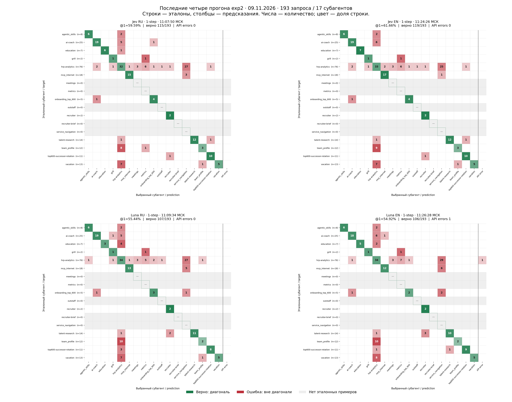

# Confusion matrix: четыре последних прогона exp2

09.11.2026. Все четыре запуска: 1-step, 193 одинаковых запроса, 17 одинаковых кандидатов. Последние два используют новый английский промпт; предыдущие два — исходный русский. Менялись одновременно язык и содержание инструкции, поэтому сравнение не выделяет эффект языка отдельно. Одного прогона недостаточно для оценки устойчивости изменений.

В матрицах строка — эталон, столбец — выбор модели. Зелёная диагональ — совпадение с разметкой. Красные ячейки — несовпадение. Числа — абсолютные количества; насыщенность цвета — доля соответствующей строки. Отказ модели/ошибка API представлен отдельным столбцом API error. Сумма каждой матрицы — 193. Серые строки имеют n=0; их качество не измерено.

| Прогон | @1 | @3 | @5 | Верно | Неправильный выбор | Ошибки API |
| --- | ---: | ---: | ---: | ---: | ---: | ---: |
| [Jev RU](jev_ru_110750.png) | 59.59% | 77.72% | 84.97% | 115 | 78 | 0 |
| [Jev EN](jev_en_112426.png) | 61.66% | 78.24% | 81.87% | 119 | 74 | 0 |
| [Luna RU](luna_ru_110934.png) | 55.44% | 79.79% | 87.56% | 107 | 86 | 0 |
| [Luna EN](luna_en_112628.png) | 54.92% | 74.61% | 77.72% | 106 | 86 | 1 |

## Изменение ошибок при новом промпте

Jev: исправлено 5 неправильных ответов RU и испорчен 1 правильный; итог +4 верных ответа (+2.07 п.п. @1). @5 упал на 6 запросов (−3.11 п.п.).

Luna: исправлено 6 неправильных ответов RU и испорчено 7 правильных; итог −1 верный ответ (−0.52 п.п. @1). @5 упал на 19 запросов (−9.84 п.п.).

У Luna EN один HTTP 502 с сообщением провайдера об отказе отвечать на вопрос subagent. Sample_id=78: вопрос о встрече Грефа со студентами и интересных вопросах от студентов, эталон hrp-analytics. В RU этот вопрос тоже был неверно направлен (mcp_internet), поэтому отказ не объясняет изменение числа правильных @1 между промптами. В RU эталон стоял на 4-м месте: отказ объясняет одну из 19 потерянных позиций hit@5, остальные 18 относятся к изменению ранжирования.

Опубликованная вероятность эталона равна нулю: Jev RU 26 → EN 33; Luna RU 6 → EN 25. Нижние места среди вариантов с одинаковой вероятностью разрешаются входным порядком; эта особенность влияет на @3/@5 и shortlist. Она не меняет число совпадений native choice на диагонали.

## Jev RU

Исходный прогон: `experiments/exp2/1-step/typesafe__jev-1.14_20261109T110750.875574+0300`.

[PNG](jev_ru_110750.png) · [SVG](jev_ru_110750.svg)

| Эталон → выбор | Количество | Пример вопроса |
| --- | ---: | --- |
| hrp-analytics → service_navigation | 27 | Где посмотреть ДМС? |
| team_profile → hrp-analytics | 8 | Топ команд трайба Исследование и аналитика по python? |
| vacation → hrp-analytics | 7 | Сколько раз сотрудник Захаров Роман выходил на работу в выходной день в этом году? |
| hrp-analytics → metrics | 6 | В каком блоке самый низкий индекс вовлеченности. Какие причины и рекомендации |
| ai-coach → hrp-analytics | 5 | Выведи подробно профиль Станислава Усышкина из блока B2C. насколько он подходит под задачу / может быть преемником |
| hrp-analytics → meetings | 3 | Поставь встречу завтра в 10:00 на час, тема — Синк по SAP |
| mcp_internet → service_navigation | 3 | каталог статей по управлению |
| agentic_skills → hrp-analytics | 2 | Найди всех сотрудников, у которых уровень навыка n4 и выше по любому из шести |
| hrp-analytics → ai-coach | 2 | Какие hard- и soft-навыки в моей команде развиты лучше всего, а какие хуже? а 360? |
| hrp-analytics → onboarding_top_600 | 1 | Мне нужен раздел со здоровьем и ДМС |
| hrp-analytics → mcp_internet | 1 | Где посмотреть транши? |
| hrp-analytics → recruiter | 1 | Хочу уволиться, куда перейти? |
| hrp-analytics → outstaff | 1 | Сколько сотрудников за штатом в банке и как это влияет на Банк? |
| team_profile → metrics | 1 | Как хобби влияет на показатель эффективности команды трайба Исследование и аналитика? |
| grill → metrics | 1 | Сделай что-то по вовлечённости |
| hrp-analytics → top600-successor-rotation | 1 | кто преемник на позицию Ани Овчинниковой? |
| hrp-analytics → grill | 1 | привет. сегодня у ГО Грефа встреча со студентами совместных образовательных программ Сбера и вузов: НИУ ВШЭ, МФТИ, РЭШ. какие вопросы ему интересно было бы услышать от ребят? |
| ai-coach → onboarding_top_600 | 1 | у меня есть новый руководитель, который вырос внутри команды и перешел на новую высокую позицию. Его зовут Артем Наместников. Как мне его лучше адаптировать в новой роли, подбери инструменты |
| top600-successor-rotation → recruiter | 1 | Кто может возглавить цифровую трансформацию банка среди внутренних и внешних кандидатов? |
| talent-research → top600-successor-rotation | 1 | дай мне список кандидатов из Новосибирска на позицию начальника управления в подразделении центр корпоративных риск решений (14 грейд). Кандидат должен жить в Новосибирске, иметь финансовое образование, понимать корпоративные финансы и отчетность и иметь опыт управления командой от 30 человек |
| talent-research → hrp-analytics | 1 | Кого из топ-600, находящихся в должности 5 и более лет, можно заменить или чью роль усилить за счет внешнего найма? |
| vacation → team_profile | 1 | Какие пересечения у меня в команде |
| education → hrp-analytics | 1 | Какой уровень обученности у Масютина Алексея? |
| onboarding_top_600 → ai-coach | 1 | Кто можем помочь с целями развития? |

## Jev EN

Исходный прогон: `experiments/exp2/1-step/typesafe__jev-1.14_20261109T112426.913512+0300`.

[PNG](jev_en_112426.png) · [SVG](jev_en_112426.svg)

| Эталон → выбор | Количество | Пример вопроса |
| --- | ---: | --- |
| hrp-analytics → service_navigation | 25 | Где посмотреть ДМС? |
| team_profile → hrp-analytics | 9 | Как хобби влияет на показатель эффективности команды трайба Исследование и аналитика? |
| vacation → hrp-analytics | 7 | Сколько раз сотрудник Захаров Роман выходил на работу в выходной день в этом году? |
| hrp-analytics → metrics | 6 | В каком блоке самый низкий индекс вовлеченности. Какие причины и рекомендации |
| ai-coach → hrp-analytics | 6 | Выведи подробно профиль Станислава Усышкина из блока B2C. насколько он подходит под задачу / может быть преемником |
| hrp-analytics → meetings | 3 | Поставь встречу завтра в 10:00 на час, тема — Синк по SAP |
| agentic_skills → hrp-analytics | 2 | Найди всех сотрудников, у которых уровень навыка n4 и выше по любому из шести |
| hrp-analytics → ai-coach | 2 | Где мой трек адаптации? |
| hrp-analytics → mcp_internet | 2 | Где пройти обучение? |
| hrp-analytics → onboarding_top_600 | 1 | Мне нужен раздел со здоровьем и ДМС |
| hrp-analytics → recruiter | 1 | Хочу уволиться, куда перейти? |
| hrp-analytics → outstaff | 1 | Сколько сотрудников за штатом в банке и как это влияет на Банк? |
| grill → metrics | 1 | Сделай что-то по вовлечённости |
| hrp-analytics → top600-successor-rotation | 1 | кто преемник на позицию Ани Овчинниковой? |
| hrp-analytics → grill | 1 | привет. сегодня у ГО Грефа встреча со студентами совместных образовательных программ Сбера и вузов: НИУ ВШЭ, МФТИ, РЭШ. какие вопросы ему интересно было бы услышать от ребят? |
| top600-successor-rotation → recruiter | 1 | Кто может возглавить цифровую трансформацию банка среди внутренних и внешних кандидатов? |
| talent-research → top600-successor-rotation | 1 | дай мне список кандидатов из Новосибирска на позицию начальника управления в подразделении центр корпоративных риск решений (14 грейд). Кандидат должен жить в Новосибирске, иметь финансовое образование, понимать корпоративные финансы и отчетность и иметь опыт управления командой от 30 человек |
| talent-research → hrp-analytics | 1 | Кого из топ-600, находящихся в должности 5 и более лет, можно заменить или чью роль усилить за счет внешнего найма? |
| vacation → team_profile | 1 | Какие пересечения у меня в команде |
| mcp_internet → service_navigation | 1 | обучение в Корпоративном университете Agile |
| onboarding_top_600 → ai-coach | 1 | Кто можем помочь с целями развития? |

## Luna RU

Исходный прогон: `experiments/exp2/1-step/openai__gpt-6-luna-decisions_20261109T110934.530535+0300`.

[PNG](luna_ru_110934.png) · [SVG](luna_ru_110934.svg)

| Эталон → выбор | Количество | Пример вопроса |
| --- | ---: | --- |
| hrp-analytics → service_navigation | 27 | Где посмотреть ДМС? |
| team_profile → hrp-analytics | 10 | Как хобби влияет на показатель эффективности команды трайба Исследование и аналитика? |
| vacation → hrp-analytics | 7 | Сколько раз сотрудник Захаров Роман выходил на работу в выходной день в этом году? |
| hrp-analytics → metrics | 5 | В каком блоке самый низкий индекс вовлеченности. Какие причины и рекомендации |
| ai-coach → hrp-analytics | 5 | Выведи подробно профиль Станислава Усышкина из блока B2C. насколько он подходит под задачу / может быть преемником |
| mcp_internet → service_navigation | 5 | найди статью про управление рисками |
| education → hrp-analytics | 4 | Какое обучение не завершено у Седелева Олега? |
| hrp-analytics → meetings | 3 | Поставь встречу завтра в 10:00 на час, тема — Синк по SAP |
| top600-successor-rotation → hrp-analytics | 3 | Выведи топ-5 кандидатов на мое место среди сотрудников компании |
| agentic_skills → hrp-analytics | 2 | Найди всех сотрудников, у которых уровень навыка n4 и выше по любому из шести |
| hrp-analytics → onboarding_top_600 | 2 | Где мой трек адаптации? |
| talent-research → recruiter | 2 | дай мне список кандидатов из Новосибирска на позицию начальника управления в подразделении центр корпоративных риск решений (14 грейд). Кандидат должен жить в Новосибирске, иметь финансовое образование, понимать корпоративные финансы и отчетность и иметь опыт управления командой от 30 человек |
| hrp-analytics → grill | 1 | Хочу уволиться, куда перейти? |
| hrp-analytics → outstaff | 1 | Сколько сотрудников за штатом в банке и как это влияет на Банк? |
| grill → metrics | 1 | Сделай что-то по вовлечённости |
| hrp-analytics → mcp_internet | 1 | привет. сегодня у ГО Грефа встреча со студентами совместных образовательных программ Сбера и вузов: НИУ ВШЭ, МФТИ, РЭШ. какие вопросы ему интересно было бы услышать от ребят? |
| hrp-analytics → team_profile | 1 | Какие hard- и soft-навыки в моей команде развиты лучше всего, а какие хуже? а 360? |
| hrp-analytics → agentic_skills | 1 | Оцени пробелы в AI  у топ руководителей по ролям и функциональным блокам. Определи, кому развитие критично в первую очередь для достижения бизнес-целей, и сформируй персонализированные треки развития с учетом их текущей загрузки и влияния на результат |
| ai-coach → grill | 1 | у меня есть новый руководитель, который вырос внутри команды и перешел на новую высокую позицию. Его зовут Артем Наместников. Как мне его лучше адаптировать в новой роли, подбери инструменты |
| talent-research → hrp-analytics | 1 | Кого из топ-600, находящихся в должности 5 и более лет, можно заменить или чью роль усилить за счет внешнего найма? |
| vacation → team_profile | 1 | Какие пересечения у меня в команде |
| onboarding_top_600 → ai-coach | 1 | Кто можем помочь с целями развития? |
| onboarding_top_600 → service_navigation | 1 | Какие у меня лимиты по командировкам? |

## Luna EN

Исходный прогон: `experiments/exp2/1-step/openai__gpt-6-luna-decisions_20261109T112628.542481+0300`.

[PNG](luna_en_112628.png) · [SVG](luna_en_112628.svg)

| Эталон → выбор | Количество | Пример вопроса |
| --- | ---: | --- |
| hrp-analytics → service_navigation | 29 | Где посмотреть ДМС? |
| team_profile → hrp-analytics | 10 | Как хобби влияет на показатель эффективности команды трайба Исследование и аналитика? |
| vacation → hrp-analytics | 8 | Сколько раз сотрудник Захаров Роман выходил на работу в выходной день в этом году? |
| hrp-analytics → metrics | 7 | Какие у меня делегирования в Пульсе? |
| ai-coach → hrp-analytics | 6 | Выведи подробно профиль Станислава Усышкина из блока B2C. насколько он подходит под задачу / может быть преемником |
| mcp_internet → service_navigation | 6 | найди статью про управление рисками |
| hrp-analytics → meetings | 3 | Поставь встречу завтра в 10:00 на час, тема — Синк по SAP |
| talent-research → recruiter | 3 | дай мне список кандидатов из Новосибирска на позицию начальника управления в подразделении центр корпоративных риск решений (14 грейд). Кандидат должен жить в Новосибирске, иметь финансовое образование, понимать корпоративные финансы и отчетность и иметь опыт управления командой от 30 человек |
| agentic_skills → hrp-analytics | 2 | Найди всех сотрудников, у которых уровень навыка n4 и выше по любому из шести |
| education → hrp-analytics | 2 | Пройдено ли обучение по PDLC? |
| onboarding_top_600 → service_navigation | 2 | Как подключить семью к ДМС? |
| hrp-analytics → onboarding_top_600 | 1 | Мне нужен раздел со здоровьем и ДМС |
| grill → metrics | 1 | Сделай что-то по вовлечённости |
| hrp-analytics → __api_error__ | 1 | привет. сегодня у ГО Грефа встреча со студентами совместных образовательных программ Сбера и вузов: НИУ ВШЭ, МФТИ, РЭШ. какие вопросы ему интересно было бы услышать от ребят? |
| hrp-analytics → ai-coach | 1 | Оцени пробелы в AI  у топ руководителей по ролям и функциональным блокам. Определи, кому развитие критично в первую очередь для достижения бизнес-целей, и сформируй персонализированные треки развития с учетом их текущей загрузки и влияния на результат |
| ai-coach → mcp_internet | 1 | Что изучить топ-менеджеру для развития длинного взгляда |
| top600-successor-rotation → hrp-analytics | 1 | Выведи топ-5 кандидатов на мое место среди сотрудников компании |
| top600-successor-rotation → talent-research | 1 | Кто может возглавить цифровую трансформацию банка среди внутренних и внешних кандидатов? |
| talent-research → hrp-analytics | 1 | Кого из топ-600, находящихся в должности 5 и более лет, можно заменить или чью роль усилить за счет внешнего найма? |
| onboarding_top_600 → ai-coach | 1 | Кто можем помочь с целями развития? |

## Все ошибки двух последних прогонов

Вероятности и confidence приведены из артефактов; это разные поля, их интерпретация зависит от модели.

### Jev EN

| ID | Вопрос | Эталон | Выбор / ошибка | P победителя | Confidence | Место эталона |
| ---: | --- | --- | --- | ---: | ---: | ---: |
| 3 | Найди всех сотрудников, у которых уровень навыка n4 и выше по любому из шести | agentic_skills | hrp-analytics | 0.87 | 0.86 | 2 |
| 4 | Кто из разработчиков в нашем подразделении достиг уровня  и работает по роли Backend-разработчик | agentic_skills | hrp-analytics | 0.93 | 0.93 | 2 |
| 8 | Где посмотреть ДМС? | hrp-analytics | service_navigation | 0.87 | 0.86 | 7 |
| 9 | Где мой трудовой договор? | hrp-analytics | service_navigation | 0.95 | 0.95 | 4 |
| 10 | Мне нужно открыть анкетирование для оценки. Куда перейти в раздел опросов? | hrp-analytics | service_navigation | 0.99 | 0.99 | 7 |
| 11 | Дай ссылку на раздел командировок. | hrp-analytics | service_navigation | 1.0 | 1 | 6 |
| 12 | Где оформить увольнение? | hrp-analytics | service_navigation | 0.87 | 0.86 | 4 |
| 13 | Где мой трек адаптации? | hrp-analytics | ai-coach | 0.38 | 0.34 | 4 |
| 14 | Где пройти обучение? | hrp-analytics | mcp_internet | 0.45 | 0.42 | 8 |
| 15 | Где оформить командировку? | hrp-analytics | service_navigation | 0.9 | 0.89 | 7 |
| 16 | Куда перейти по командировкам? | hrp-analytics | service_navigation | 1.0 | 1 | 6 |
| 17 | Где пройти опрос? | hrp-analytics | service_navigation | 0.96 | 0.96 | 7 |
| 18 | Где получить документы сотрудника | hrp-analytics | service_navigation | 0.98 | 0.98 | 7 |
| 19 | Как оформить декрет | hrp-analytics | service_navigation | 0.66 | 0.64 | 5 |
| 20 | Куда обратиться по справкам | hrp-analytics | service_navigation | 0.98 | 0.98 | 7 |
| 21 | Где мой LTI? | hrp-analytics | service_navigation | 0.98 | 0.98 | 7 |
| 22 | Мне нужен раздел со здоровьем и ДМС | hrp-analytics | onboarding_top_600 | 0.55 | 0.52 | 8 |
| 23 | Скинь ссылку на ДМС | hrp-analytics | service_navigation | 0.94 | 0.94 | 7 |
| 24 | Скинь ссылку на РОТ | hrp-analytics | service_navigation | 0.99 | 0.99 | 7 |
| 25 | Где посмотреть транши? | hrp-analytics | mcp_internet | 0.52 | 0.49 | 7 |
| 26 | Где получить 2-НДФЛ? | hrp-analytics | service_navigation | 0.98 | 0.98 | 7 |
| 27 | Мне нужна справка НДФЛ | hrp-analytics | service_navigation | 0.96 | 0.96 | 3 |
| 28 | Скинь ссылку на все мои документы | hrp-analytics | service_navigation | 1.0 | 1 | 6 |
| 29 | Хочу уволиться, куда перейти? | hrp-analytics | recruiter | 0.57 | 0.54 | 6 |
| 30 | Где посмотреть адаптацию? | hrp-analytics | service_navigation | 0.77 | 0.76 | 8 |
| 31 | Скинь ссылку на адаптационный трек | hrp-analytics | service_navigation | 0.87 | 0.86 | 8 |
| 32 | Где посмотреть обучение? | hrp-analytics | service_navigation | 0.61 | 0.59 | 8 |
| 33 | Дай ссылку на обучение | hrp-analytics | service_navigation | 0.58 | 0.55 | 8 |
| 34 | Куда перейти по отпускам и отсутствиям? | hrp-analytics | service_navigation | 0.98 | 0.98 | 7 |
| 35 | Дай ссылку на раздел отсутствий | hrp-analytics | service_navigation | 1.0 | 1 | 6 |
| 36 | Скинь ссылку на сервис опросов | hrp-analytics | service_navigation | 0.99 | 0.99 | 7 |
| 37 | Дай ссылку на сервис для оформления увольнения. | hrp-analytics | service_navigation | 0.97 | 0.97 | 3 |
| 42 | В каком блоке самый низкий индекс вовлеченности. Какие причины и рекомендации | hrp-analytics | metrics | 0.98 | 0.98 | 2 |
| 43 | В каких командах индекс вовлеченности меньше 70%? Почему так | hrp-analytics | metrics | 0.98 | 0.98 | 2 |
| 44 | Какой уровень вовлеченности в моей команде и какие практические рекомендации можно дать? | hrp-analytics | metrics | 0.99 | 0.99 | 2 |
| 45 | Сделай короткое саммари комментариев по моей команде по опросу вовлеченности и выдели особо критичные | hrp-analytics | metrics | 0.99 | 0.99 | 2 |
| 46 | Покажи топ-5 команд с самой низкой вовлечённостью. Каковы причины и чем это может грозить? | hrp-analytics | metrics | 0.98 | 0.98 | 2 |
| 47 | Сколько сотрудников за штатом в банке и как это влияет на Банк? | hrp-analytics | outstaff | 0.91 | 0.9 | 2 |
| 49 | Как хобби влияет на показатель эффективности команды трайба Исследование и аналитика? | team_profile | hrp-analytics | 0.45 | 0.42 | 3 |
| 50 | Топ команд трайба Исследование и аналитика по python? | team_profile | hrp-analytics | 0.96 | 0.96 | 4 |
| 51 | В какой команде трайба Исследование и аналитика больше всего бегунов? | team_profile | hrp-analytics | 0.99 | 0.99 | 15 |
| 52 | Где в КиБ больше всего теннисистов? Выведи топ-15 подразделений | team_profile | hrp-analytics | 0.97 | 0.97 | 15 |
| 53 | Доля питонистов по блокам и отдельно в разрезе ТБ? | team_profile | hrp-analytics | 0.96 | 0.96 | 3 |
| 54 | Покажи руководителей команд и ключевых экспертов с подтвержденной компетенцией в Machine Learning: кто они, в каких подразделениях работают и какой уровень экспертизы имеют? | team_profile | hrp-analytics | 0.97 | 0.97 | 3 |
| 57 | Сколько бегунов в трайбе Исследование и аналитика? | team_profile | hrp-analytics | 0.99 | 0.99 | 2 |
| 58 | Сколько футболистов в трайбе Исследование и аналитика? | team_profile | hrp-analytics | 0.99 | 0.99 | 2 |
| 59 | Топ команд Блока Т по ML? Укажи численность и зоной отвественности | team_profile | hrp-analytics | 0.99 | 0.99 | 15 |
| 70 | Сделай что-то по вовлечённости | grill | metrics | 0.67 | 0.65 | 2 |
| 71 | Поставь встречу завтра в 10:00 на час, тема — Синк по SAP | hrp-analytics | meetings | 1.0 | 1 | 6 |
| 72 | Организуй завтра после со мной на час, тема — Синк по SAP | hrp-analytics | meetings | 1.0 | 1 | 6 |
| 73 | Поставь встречу | hrp-analytics | meetings | 1.0 | 1 | 6 |
| 74 | кто преемник на позицию Ани Овчинниковой? | hrp-analytics | top600-successor-rotation | 0.72 | 0.7 | 2 |
| 78 | привет. сегодня у ГО Грефа встреча со студентами совместных образовательных программ Сбера и вузов: НИУ ВШЭ, МФТИ, РЭШ. какие вопросы ему интересно было бы услышать от ребят? | hrp-analytics | grill | 0.56 | 0.53 | 6 |
| 82 | Оцени пробелы в AI  у топ руководителей по ролям и функциональным блокам. Определи, кому развитие критично в первую очередь для достижения бизнес-целей, и сформируй персонализированные треки развития с учетом их текущей загрузки и влияния на результат | hrp-analytics | ai-coach | 0.65 | 0.63 | 3 |
| 86 | Покажи команды с признаками выгорания: переработки, низкий eNPS, рост больничных, текучесть выше нормы. Что делать? | hrp-analytics | metrics | 0.8 | 0.79 | 2 |
| 102 | Выведи подробно профиль Станислава Усышкина из блока B2C. насколько он подходит под задачу / может быть преемником | ai-coach | hrp-analytics | 0.83 | 0.82 | 4 |
| 105 | Сформируй командный отчет по оценке 360 по следующим руководителям топ-600 блока Риски. Что это значит | ai-coach | hrp-analytics | 0.58 | 0.55 | 2 |
| 108 | У кого из руководителей блока самые низкие оценки 360? И почему? | ai-coach | hrp-analytics | 0.91 | 0.9 | 2 |
| 110 | Какие мои оценки? | ai-coach | hrp-analytics | 0.77 | 0.76 | 2 |
| 112 | покажи профиль моей роли | ai-coach | hrp-analytics | 0.69 | 0.67 | 3 |
| 113 | Сравни оценки 360 руководителей топ-600 с результатами их блоков: средняя оценка 360 по блоку, динамика и ключевые расхождения. | ai-coach | hrp-analytics | 0.95 | 0.95 | 2 |
| 131 | Кто может возглавить цифровую трансформацию банка среди внутренних и внешних кандидатов? | top600-successor-rotation | recruiter | 0.41 | 0.37 | 2 |
| 135 | дай мне список кандидатов из Новосибирска на позицию начальника управления в подразделении центр корпоративных риск решений (14 грейд). Кандидат должен жить в Новосибирске, иметь финансовое образование, понимать корпоративные финансы и отчетность и иметь опыт управления командой от 30 человек | talent-research | top600-successor-rotation | 0.43 | 0.39 | 3 |
| 139 | Кого из топ-600, находящихся в должности 5 и более лет, можно заменить или чью роль усилить за счет внешнего найма? | talent-research | hrp-analytics | 0.49 | 0.46 | 4 |
| 149 | Сколько раз сотрудник Захаров Роман выходил на работу в выходной день в этом году? | vacation | hrp-analytics | 0.99 | 0.99 | 17 |
| 150 | С какой частотой сотрудник Седелев Олег привлекался к работе в нерабочие дни в текущем году? | vacation | hrp-analytics | 0.98 | 0.98 | 17 |
| 151 | Сколько раз сотрудник сотрудники моего трайба привлекались к работе в выходные? | vacation | hrp-analytics | 0.98 | 0.98 | 17 |
| 152 | Сколько РВД у меня? | vacation | hrp-analytics | 0.62 | 0.6 | 2 |
| 153 | Количество выходов в выходной по сотруднику с ТН 1724242 | vacation | hrp-analytics | 0.95 | 0.95 | 2 |
| 154 | Количество выходов в выходной день у сотрудника с ТН 10095116 за прошлый месяц | vacation | hrp-analytics | 0.99 | 0.99 | 2 |
| 155 | Покажи статистику переработок по сотруднику сотрудник с ТН 2136883 в этом году | vacation | hrp-analytics | 0.99 | 0.99 | 17 |
| 157 | Какие пересечения у меня в команде | vacation | team_profile | 0.53 | 0.5 | 2 |
| 183 | обучение в Корпоративном университете Agile | mcp_internet | service_navigation | 0.49 | 0.46 | 2 |
| 191 | Кто можем помочь с целями развития? | onboarding_top_600 | ai-coach | 0.75 | 0.73 | 2 |

### Luna EN

| ID | Вопрос | Эталон | Выбор / ошибка | P победителя | Confidence | Место эталона |
| ---: | --- | --- | --- | ---: | ---: | ---: |
| 3 | Найди всех сотрудников, у которых уровень навыка n4 и выше по любому из шести | agentic_skills | hrp-analytics | 0.76 | 0.75 | 2 |
| 4 | Кто из разработчиков в нашем подразделении достиг уровня  и работает по роли Backend-разработчик | agentic_skills | hrp-analytics | 0.75 | 0.73 | 2 |
| 8 | Где посмотреть ДМС? | hrp-analytics | service_navigation | 0.93 | 0.93 | 8 |
| 9 | Где мой трудовой договор? | hrp-analytics | service_navigation | 0.85 | 0.84 | 2 |
| 10 | Мне нужно открыть анкетирование для оценки. Куда перейти в раздел опросов? | hrp-analytics | service_navigation | 0.97 | 0.97 | 6 |
| 11 | Дай ссылку на раздел командировок. | hrp-analytics | service_navigation | 0.99 | 0.99 | 7 |
| 12 | Где оформить увольнение? | hrp-analytics | service_navigation | 0.92 | 0.92 | 6 |
| 13 | Где мой трек адаптации? | hrp-analytics | service_navigation | 0.38 | 0.34 | 11 |
| 14 | Где пройти обучение? | hrp-analytics | service_navigation | 0.87 | 0.86 | 6 |
| 15 | Где оформить командировку? | hrp-analytics | service_navigation | 0.97 | 0.97 | 7 |
| 16 | Куда перейти по командировкам? | hrp-analytics | service_navigation | 0.95 | 0.95 | 8 |
| 17 | Где пройти опрос? | hrp-analytics | service_navigation | 0.94 | 0.94 | 6 |
| 18 | Где получить документы сотрудника | hrp-analytics | service_navigation | 0.96 | 0.96 | 4 |
| 19 | Как оформить декрет | hrp-analytics | service_navigation | 0.92 | 0.92 | 7 |
| 20 | Куда обратиться по справкам | hrp-analytics | service_navigation | 0.99 | 0.99 | 7 |
| 21 | Где мой LTI? | hrp-analytics | service_navigation | 0.97 | 0.97 | 7 |
| 22 | Мне нужен раздел со здоровьем и ДМС | hrp-analytics | onboarding_top_600 | 0.92 | 0.92 | 10 |
| 23 | Скинь ссылку на ДМС | hrp-analytics | service_navigation | 0.95 | 0.95 | 8 |
| 24 | Скинь ссылку на РОТ | hrp-analytics | service_navigation | 0.98 | 0.98 | 8 |
| 25 | Где посмотреть транши? | hrp-analytics | service_navigation | 0.81 | 0.8 | 2 |
| 26 | Где получить 2-НДФЛ? | hrp-analytics | service_navigation | 0.94 | 0.94 | 8 |
| 27 | Мне нужна справка НДФЛ | hrp-analytics | service_navigation | 0.95 | 0.95 | 8 |
| 28 | Скинь ссылку на все мои документы | hrp-analytics | service_navigation | 0.97 | 0.97 | 7 |
| 29 | Хочу уволиться, куда перейти? | hrp-analytics | service_navigation | 0.51 | 0.48 | 3 |
| 30 | Где посмотреть адаптацию? | hrp-analytics | service_navigation | 0.95 | 0.95 | 8 |
| 31 | Скинь ссылку на адаптационный трек | hrp-analytics | service_navigation | 0.81 | 0.8 | 10 |
| 32 | Где посмотреть обучение? | hrp-analytics | service_navigation | 0.87 | 0.86 | 7 |
| 33 | Дай ссылку на обучение | hrp-analytics | service_navigation | 0.76 | 0.75 | 8 |
| 34 | Куда перейти по отпускам и отсутствиям? | hrp-analytics | service_navigation | 0.9 | 0.89 | 7 |
| 35 | Дай ссылку на раздел отсутствий | hrp-analytics | service_navigation | 0.96 | 0.96 | 8 |
| 36 | Скинь ссылку на сервис опросов | hrp-analytics | service_navigation | 0.97 | 0.97 | 8 |
| 37 | Дай ссылку на сервис для оформления увольнения. | hrp-analytics | service_navigation | 0.98 | 0.98 | 7 |
| 39 | Какие у меня делегирования в Пульсе? | hrp-analytics | metrics | 0.34 | 0.3 | 3 |
| 42 | В каком блоке самый низкий индекс вовлеченности. Какие причины и рекомендации | hrp-analytics | metrics | 0.96 | 0.96 | 3 |
| 43 | В каких командах индекс вовлеченности меньше 70%? Почему так | hrp-analytics | metrics | 0.95 | 0.95 | 8 |
| 44 | Какой уровень вовлеченности в моей команде и какие практические рекомендации можно дать? | hrp-analytics | metrics | 0.97 | 0.97 | 7 |
| 45 | Сделай короткое саммари комментариев по моей команде по опросу вовлеченности и выдели особо критичные | hrp-analytics | metrics | 0.99 | 0.99 | 7 |
| 46 | Покажи топ-5 команд с самой низкой вовлечённостью. Каковы причины и чем это может грозить? | hrp-analytics | metrics | 0.95 | 0.95 | 5 |
| 49 | Как хобби влияет на показатель эффективности команды трайба Исследование и аналитика? | team_profile | hrp-analytics | 0.39 | 0.35 | 2 |
| 50 | Топ команд трайба Исследование и аналитика по python? | team_profile | hrp-analytics | 0.71 | 0.69 | 11 |
| 51 | В какой команде трайба Исследование и аналитика больше всего бегунов? | team_profile | hrp-analytics | 0.88 | 0.87 | 3 |
| 52 | Где в КиБ больше всего теннисистов? Выведи топ-15 подразделений | team_profile | hrp-analytics | 0.92 | 0.92 | 8 |
| 53 | Доля питонистов по блокам и отдельно в разрезе ТБ? | team_profile | hrp-analytics | 0.71 | 0.69 | 15 |
| 54 | Покажи руководителей команд и ключевых экспертов с подтвержденной компетенцией в Machine Learning: кто они, в каких подразделениях работают и какой уровень экспертизы имеют? | team_profile | hrp-analytics | 0.75 | 0.73 | 3 |
| 55 | Чем занимаются в свободное время сотрудники трайба Исследование и аналитика? | team_profile | hrp-analytics | 0.53 | 0.5 | 4 |
| 57 | Сколько бегунов в трайбе Исследование и аналитика? | team_profile | hrp-analytics | 0.82 | 0.81 | 15 |
| 58 | Сколько футболистов в трайбе Исследование и аналитика? | team_profile | hrp-analytics | 0.85 | 0.84 | 10 |
| 59 | Топ команд Блока Т по ML? Укажи численность и зоной отвественности | team_profile | hrp-analytics | 0.9 | 0.89 | 9 |
| 70 | Сделай что-то по вовлечённости | grill | metrics | 0.86 | 0.85 | 2 |
| 71 | Поставь встречу завтра в 10:00 на час, тема — Синк по SAP | hrp-analytics | meetings | 0.97 | 0.97 | 8 |
| 72 | Организуй завтра после со мной на час, тема — Синк по SAP | hrp-analytics | meetings | 0.94 | 0.94 | 9 |
| 73 | Поставь встречу | hrp-analytics | meetings | 0.99 | 0.99 | 7 |
| 78 | привет. сегодня у ГО Грефа встреча со студентами совместных образовательных программ Сбера и вузов: НИУ ВШЭ, МФТИ, РЭШ. какие вопросы ему интересно было бы услышать от ребят? | hrp-analytics | RuntimeError: HTTP 502: {"error":{"message":"OpenAI refused to answer question \"subagent\"","code":502}} | None | None | None |
| 82 | Оцени пробелы в AI  у топ руководителей по ролям и функциональным блокам. Определи, кому развитие критично в первую очередь для достижения бизнес-целей, и сформируй персонализированные треки развития с учетом их текущей загрузки и влияния на результат | hrp-analytics | ai-coach | 0.4 | 0.36 | 3 |
| 86 | Покажи команды с признаками выгорания: переработки, низкий eNPS, рост больничных, текучесть выше нормы. Что делать? | hrp-analytics | metrics | 0.66 | 0.64 | 2 |
| 102 | Выведи подробно профиль Станислава Усышкина из блока B2C. насколько он подходит под задачу / может быть преемником | ai-coach | hrp-analytics | 0.88 | 0.87 | 5 |
| 105 | Сформируй командный отчет по оценке 360 по следующим руководителям топ-600 блока Риски. Что это значит | ai-coach | hrp-analytics | 0.73 | 0.71 | 2 |
| 108 | У кого из руководителей блока самые низкие оценки 360? И почему? | ai-coach | hrp-analytics | 0.8 | 0.79 | 2 |
| 110 | Какие мои оценки? | ai-coach | hrp-analytics | 0.65 | 0.63 | 2 |
| 112 | покажи профиль моей роли | ai-coach | hrp-analytics | 0.42 | 0.38 | 2 |
| 113 | Сравни оценки 360 руководителей топ-600 с результатами их блоков: средняя оценка 360 по блоку, динамика и ключевые расхождения. | ai-coach | hrp-analytics | 0.93 | 0.93 | 2 |
| 114 | Что изучить топ-менеджеру для развития длинного взгляда | ai-coach | mcp_internet | 0.37 | 0.33 | 2 |
| 124 | Выведи топ-5 кандидатов на мое место среди сотрудников компании | top600-successor-rotation | hrp-analytics | 0.58 | 0.55 | 2 |
| 131 | Кто может возглавить цифровую трансформацию банка среди внутренних и внешних кандидатов? | top600-successor-rotation | talent-research | 0.21 | 0.16 | 3 |
| 135 | дай мне список кандидатов из Новосибирска на позицию начальника управления в подразделении центр корпоративных риск решений (14 грейд). Кандидат должен жить в Новосибирске, иметь финансовое образование, понимать корпоративные финансы и отчетность и иметь опыт управления командой от 30 человек | talent-research | recruiter | 0.85 | 0.84 | 3 |
| 136 | Кто из ТОПов на рынке сейчас мог бы возглавить разработку Гигачат? | talent-research | recruiter | 0.31 | 0.27 | 5 |
| 137 | Сформируй профиль кандидата и стратегию поиска Технического директора для банка: уровень (ТБ/ГОСБ/ПЦП), ключевые требования (Agile/DevOps, импортозамещение, AI/ML, Core Banking), целевые компании и каналы выхода на кандидатов. С кого можно начинать | talent-research | recruiter | 0.66 | 0.64 | 2 |
| 139 | Кого из топ-600, находящихся в должности 5 и более лет, можно заменить или чью роль усилить за счет внешнего найма? | talent-research | hrp-analytics | 0.55 | 0.52 | 6 |
| 149 | Сколько раз сотрудник Захаров Роман выходил на работу в выходной день в этом году? | vacation | hrp-analytics | 0.88 | 0.87 | 3 |
| 150 | С какой частотой сотрудник Седелев Олег привлекался к работе в нерабочие дни в текущем году? | vacation | hrp-analytics | 0.89 | 0.88 | 3 |
| 151 | Сколько раз сотрудник сотрудники моего трайба привлекались к работе в выходные? | vacation | hrp-analytics | 0.91 | 0.9 | 9 |
| 152 | Сколько РВД у меня? | vacation | hrp-analytics | 0.8 | 0.79 | 2 |
| 153 | Количество выходов в выходной по сотруднику с ТН 1724242 | vacation | hrp-analytics | 0.82 | 0.81 | 2 |
| 154 | Количество выходов в выходной день у сотрудника с ТН 10095116 за прошлый месяц | vacation | hrp-analytics | 0.91 | 0.9 | 3 |
| 155 | Покажи статистику переработок по сотруднику сотрудник с ТН 2136883 в этом году | vacation | hrp-analytics | 0.93 | 0.93 | 8 |
| 157 | Какие пересечения у меня в команде | vacation | hrp-analytics | 0.33 | 0.29 | 3 |
| 166 | Пройдено ли обучение по PDLC? | education | hrp-analytics | 0.64 | 0.62 | 2 |
| 167 | Какое обучение должна пройти в августе? | education | hrp-analytics | 0.46 | 0.43 | 2 |
| 175 | найди статью про управление рисками | mcp_internet | service_navigation | 0.3 | 0.26 | 2 |
| 178 | каталог статей по управлению | mcp_internet | service_navigation | 0.5 | 0.47 | 2 |
| 179 | весь каталог статей по финтеху | mcp_internet | service_navigation | 0.51 | 0.48 | 2 |
| 183 | обучение в Корпоративном университете Agile | mcp_internet | service_navigation | 0.63 | 0.61 | 8 |
| 186 | обучение в Сбер университете | mcp_internet | service_navigation | 0.65 | 0.63 | 4 |
| 187 | обучение в КУ информационной безопасности | mcp_internet | service_navigation | 0.54 | 0.51 | 3 |
| 190 | Как подключить семью к ДМС? | onboarding_top_600 | service_navigation | 0.82 | 0.81 | 2 |
| 191 | Кто можем помочь с целями развития? | onboarding_top_600 | ai-coach | 0.58 | 0.55 | 2 |
| 192 | Какие у меня лимиты по командировкам? | onboarding_top_600 | service_navigation | 0.71 | 0.69 | 2 |

## Данные

- [Матрицы, подписи, размеры строк и метаданные](matrices.json)
- [Все ошибочные случаи четырёх прогонов](errors_all4.jsonl)

Суммы строк, диагонали, ошибки API и hit@1/3/5 сверены с сырыми ответами и metrics.json. Данные, промпты и результаты прогонов не изменялись.
